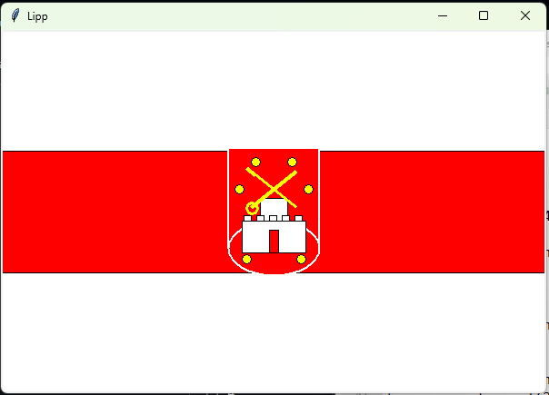
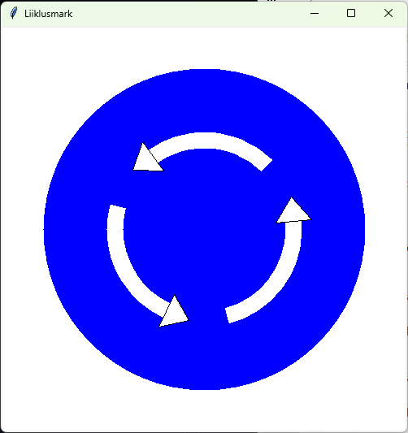
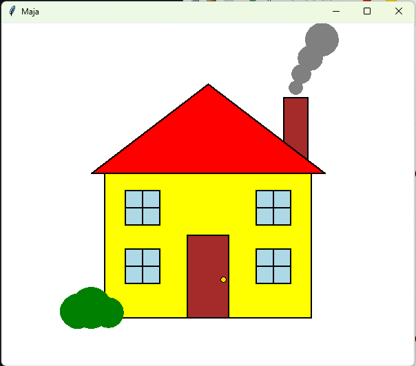
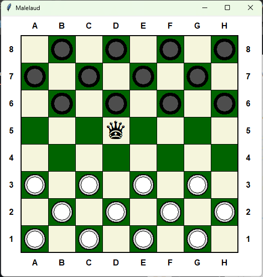
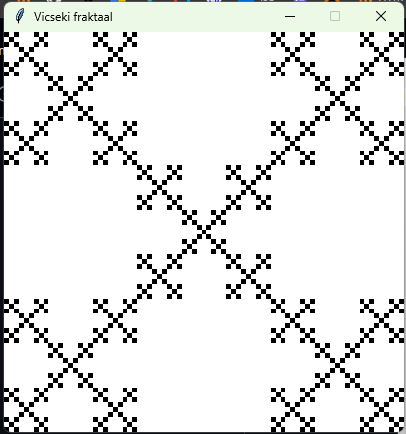
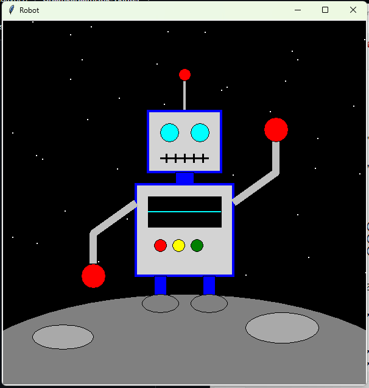

# Python Tkinter joonistuste galerii

### 1. Tartu linna lipp

---

### 2. Liiklusmärk (438 "Ringliiklus")

---

### 3. Maja

---

### 4. Malelaud ja kabenupud

---

### 5. Vicseki Fraktaal

---

### 6. Sõbralik Kosmoserobot (Vabajoonistus)

